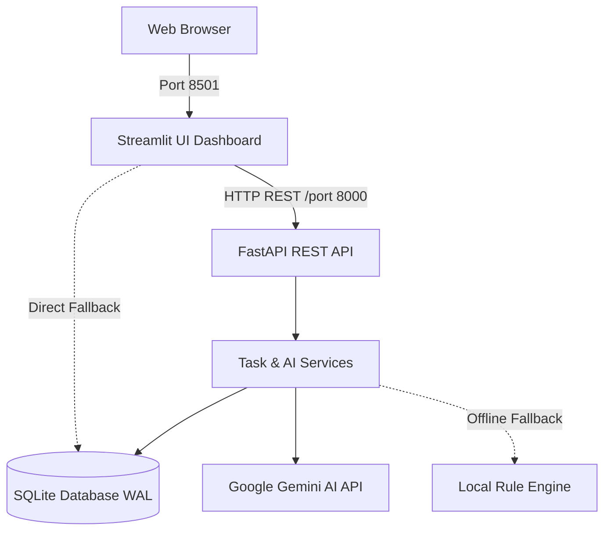

# Smart Task Manager — System Architecture & Component Specification

## Overview
Smart Task Manager is a full-stack, AI-powered productivity application designed for individuals and teams to organize tasks, predict priorities, track subtasks, and analyze productivity trends.

## Tech Stack
- **Backend:** FastAPI (Python 3.10+), Uvicorn ASGI server
- **Data Modeling & Validation:** Pydantic v2 & Pydantic Settings
- **Persistence & ORM:** SQLAlchemy 2.0 with SQLite in Write-Ahead Logging (`WAL`) mode
- **Frontend Dashboard:** Streamlit with customized glassmorphic dark theme and Altair visualizations
- **AI Intelligence:** Google Gemini AI API (`google-genai` SDK) with heuristic offline fallback
- **Automated Testing:** Pytest 8.x with in-memory SQLite isolation

## Core Backend Subsystems

### 1. `app.core.database`
- Configures SQLAlchemy engine with `sqlite:///./data/tasks.db`.
- Enables SQLite WAL mode (`PRAGMA journal_mode=WAL`), normal synchronization (`PRAGMA synchronous=NORMAL`), and foreign key enforcement (`PRAGMA foreign_keys=ON`) via connection events.
- Provides thread-safe `get_db` generator dependency for FastAPI request lifecycles.

### 2. `app.models.task`
- Defines the `tasks` schema:
  - `id`: Auto-incrementing primary key
  - `uuid`: Public identifier for external references
  - `title`: Task summary
  - `description`: Extended notes
  - `done`: Boolean completion flag
  - `status`: Lifecycle state (`pending`, `in_progress`, `completed`, `cancelled`)
  - `priority`: Classification (`urgent`, `high`, `medium`, `low`)
  - `category`: Domain tag (`work`, `personal`, `study`, `health`, `finance`)
  - `due`: ISO date string
  - `is_ai_generated`: Tracking whether AI suggested the priority
  - `is_archived`: Soft deletion state
  - `subtasks`: Serialized JSON list of subtask items
  - `position`: Integer for drag-and-drop / manual reordering
  - `created_at` / `updated_at`: UTC timestamps

### 3. `app.services.ai_service`
- Wraps Gemini API calls with graceful degradation:
  - `suggest_priority(title, description)`
  - `decompose_task(title, description)`
  - `generate_productivity_insights(summary_stats)`
- If `GOOGLE_API_KEY` is unset or an API quota/network error occurs, `AIService` falls back automatically to keyword-based heuristics, ensuring zero interruption to the user experience.

### 4. `app.services.task_service`
- Handles business logic, transactional integrity, filtering, search, and statistical aggregations.
- Wraps all database mutations in `try...except...db.rollback()`.
